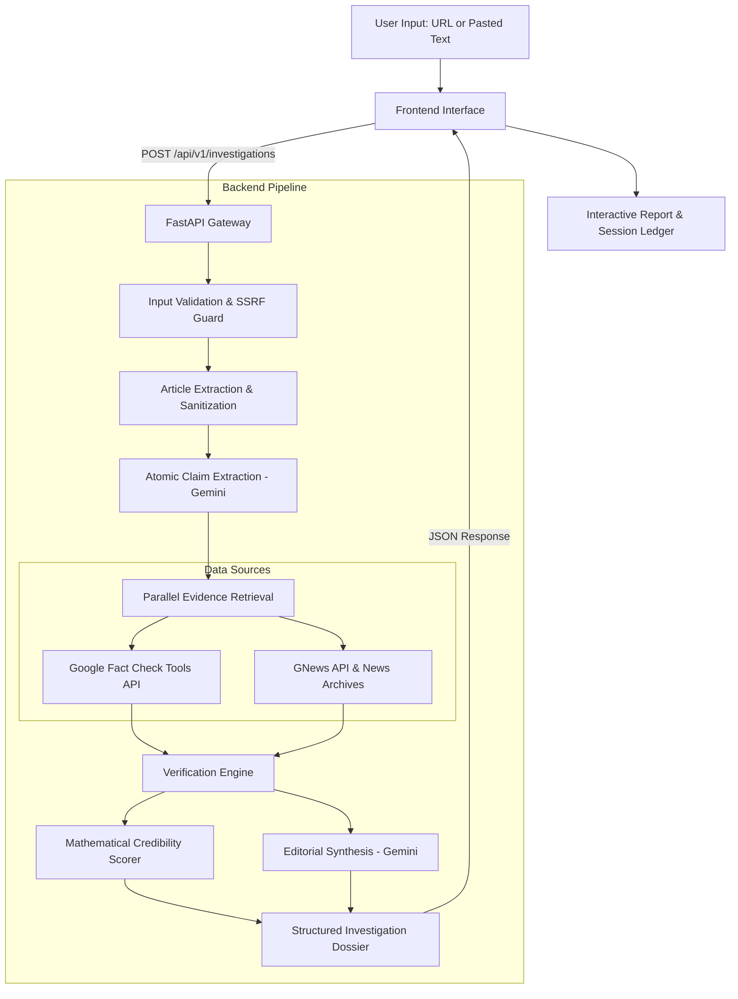

# TruthLens — AI-Powered News & Claim Verification System

[](https://www.python.org/)
[](https://fastapi.tiangolo.com/)
[](LICENSE)
[]()

TruthLens is an AI-powered news and claim verification platform designed to combat misinformation through automated, evidence-grounded investigations. By pairing LLM reasoning with real-time news wire retrieval, registered fact-checks, and a deterministic mathematical scoring formula, TruthLens produces transparent, audit-ready verification dossiers.

---

## Architecture Overview



---

## Repository Structure

```text
AI-News-Verification-System/
├── frontend/                     # Client web interface
│   ├── index.html                # Editorial landing page & interactive verification demo
│   ├── verify.html               # Real-time investigation workspace
│   ├── samples.html              # Curated pre-indexed case studies
│   ├── ledger.html               # Searchable local investigation audit ledger
│   ├── how-it-works.html         # Pipeline architecture & stage-by-stage guide
│   ├── methodology.html          # Mathematical scoring formula & bias safeguards
│   ├── style.css                 # Custom design tokens, typography & dark theme
│   ├── script.js                 # API orchestrator, state manager & ledger persistence
│   └── hero-library-bg.jpg       # Hero visual asset
├── backend/                      # FastAPI asynchronous backend service
│   ├── app/
│   │   ├── api/routes/           # API routes (/health, /investigations)
│   │   ├── core/                 # App configuration, exceptions & SSRF defenses
│   │   ├── schemas/              # Pydantic v2 validation models & schemas
│   │   ├── services/             # Extraction, retrieval, verification, scoring & synthesis
│   │   ├── integrations/         # Gemini, GNews, and Fact Check API clients
│   │   └── main.py               # FastAPI entry point, CORS & static frontend mount
│   ├── tests/                    # 34 comprehensive asynchronous unit & integration tests
│   ├── .env.example              # Environment variables template
│   ├── pytest.ini                # Pytest configuration
│   ├── requirements.txt          # Production dependencies
│   └── README.md                 # Dedicated backend documentation
├── .gitignore                    # Git ignore specifications
└── README.md                     # Root project documentation
```

---

## Key Features

1. **Dual Input Modes**: Verify articles via direct URL (with built-in anti-SSRF protections and HTML sanitization) or via raw pasted claim text.
2. **Atomic Claim Extraction**: Uses Google Gemini structured output to break complex reports into discrete, falsifiable factual assertions.
3. **Cross-Referenced Evidence Retrieval**: Concurrently queries registered fact-checking desks (Google Fact Check Tools API) and open news archives (GNews API).
4. **Deterministic Credibility Formula (0–100)**: Calculates credibility using an explicit mathematical model:
   - High-credibility corroboration rewards (+18 to +25 pts)
   - Contradicted claims penalize severely (-30 to -40 pts)
   - Insufficient evidence bounds uncertainty
   - Final score is clamped from 0 to 100 with clear rating tiers.
5. **Neutral Editorial Synthesis**: Generates balanced summaries strictly grounded in verified facts, highlighting confidence bounds and investigative limitations.
6. **Session Ledger**: Persists verified cases in the browser's local storage for export, auditability, and comparative review.
7. **Mock Fallback Mode**: Fully testable offline or without third-party API keys (`ENABLE_MOCK_FALLBACK=true`).

---

## Getting Started

### 1. Prerequisites
- **Python**: 3.10 or higher
- **Modern Web Browser**: Chrome, Edge, Firefox, or Safari

---

### 2. Backend Setup

1. Navigate to the `backend/` directory:
   ```bash
   cd backend
   ```

2. Create and activate a virtual environment:
   ```bash
   # Windows (PowerShell)
   python -m venv venv
   .\venv\Scripts\Activate.ps1

   # macOS / Linux
   python3 -m venv venv
   source venv/bin/activate
   ```

3. Install dependencies:
   ```bash
   pip install -r requirements.txt
   ```

4. Configure environment variables:
   ```bash
   cp .env.example .env
   ```
   Open `.env` and configure your API keys (optional; mock mode activates automatically if keys are omitted):
   - `GEMINI_API_KEY` ([Google AI Studio](https://aistudio.google.com/))
   - `GNEWS_API_KEY` ([GNews](https://gnews.io/))
   - `FACTCHECK_API_KEY` ([Google Fact Check Tools](https://console.cloud.google.com/))

5. Start the backend server:
   ```bash
   uvicorn app.main:app --host 127.0.0.1 --port 8000 --reload
   ```

---

### 3. Frontend Setup

You can run the frontend in either of two ways:

#### Option A: Unified FastAPI Mount (Easiest)
When running the FastAPI backend server above, visit:
- **Web App**: [http://127.0.0.1:8000/](http://127.0.0.1:8000/)
- **Interactive Swagger Docs**: [http://127.0.0.1:8000/docs](http://127.0.0.1:8000/docs)

#### Option B: Dedicated Frontend Server
If you prefer running the frontend standalone (e.g., during frontend-only editing):
```bash
cd frontend
python -m http.server 3000
```
Open [http://localhost:3000](http://localhost:3000). The frontend is pre-configured to communicate with `http://127.0.0.1:8000/api/v1`.

---

## Running Automated Tests

Run the complete backend test suite using `pytest`:

```bash
cd backend
pytest -v
```

All 34 test cases test SSRF defense, article scraping, claim extraction, evidence matching, scoring algorithms, and endpoint responses.

---

## API Endpoints

| Method | Endpoint | Description |
|---|---|---|
| `GET` | `/` | Serves web app (HTML) or API metadata (JSON) |
| `GET` | `/api/v1/health` | Health status and API key integration status |
| `POST` | `/api/v1/investigations` | Initiates claim/URL verification pipeline |
| `GET` | `/docs` | Interactive Swagger API documentation |
| `GET` | `/redoc` | OpenAPI ReDoc documentation |

---

## Security & Ethics Safeguards

- **SSRF Defense**: Validates and restricts URL schemes, denies access to loopback (`127.0.0.1`), link-local, private RFC 1918 networks, and cloud instance metadata endpoints (`169.254.169.254`).
- **Grounded Verification**: The system is designed to report "Insufficient Evidence" when verified facts cannot be located, rather than speculating.
- **Auditable Ledger**: Every analysis is preserved with timestamp, claim breakdown, and source attribution for review.
